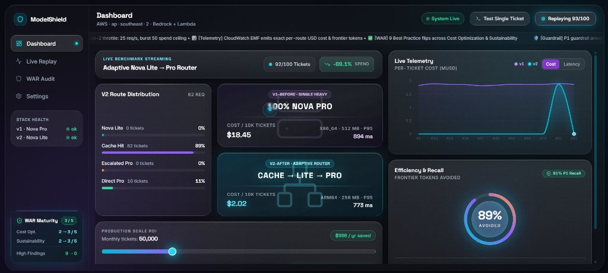
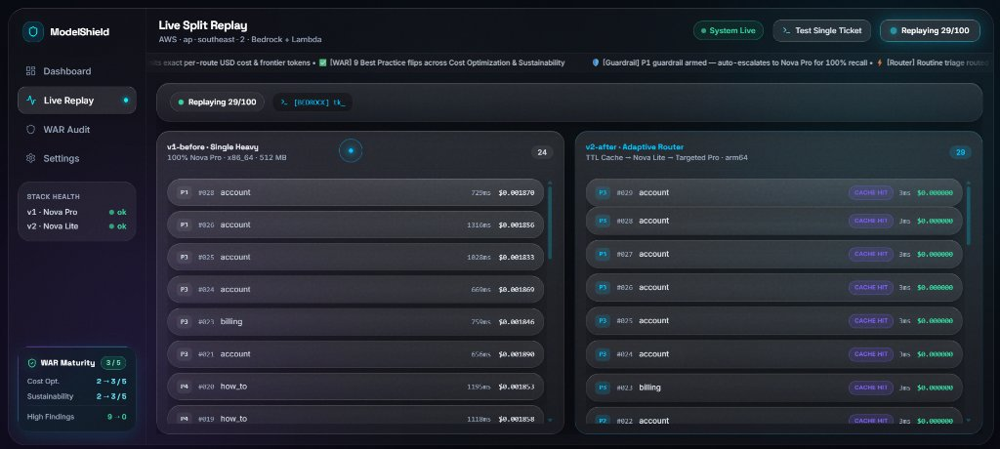
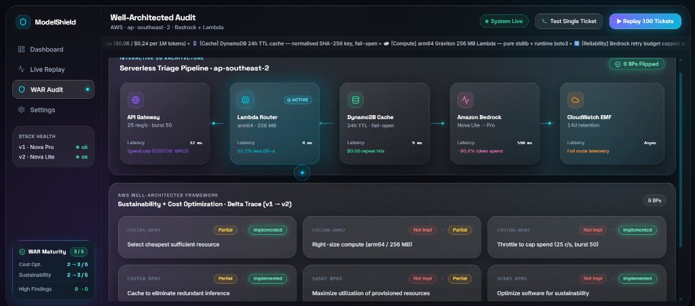

# ModelShield

> **Self-optimising, security-hardened serverless AI incident-triage gateway on AWS.**
> Built with `API Gateway → Lambda → Amazon Bedrock → DynamoDB → CloudWatch`, running `v1-before` (100% Amazon Nova Pro) side by side against `v2-after` (DynamoDB TTL cache + confidence-gated Nova Lite → Nova Pro router) on `arm64` Graviton.

[-FF9900?style=flat-square&logo=amazonaws&logoColor=white)](infra/template.yaml)
[](backend/src/router.py)
[](.github/workflows/security.yml)
[](backend/tests/)
[](docs/war-diff.md)
[](LICENSE)

🌐 **Live CloudFront Demo:** https://d1856jwkm5m4pg.cloudfront.net



---

## Overview

**ModelShield** is a production-minded AWS serverless AI incident-triage gateway designed to eliminate unnecessary frontier LLM spend while preserving 100% critical incident recall (`P1`) and enforcing defense-in-depth cloud and application security.

Instead of asserting theoretical savings, ModelShield deploys two identical-contract API stacks in `ap-southeast-2` (`modelshield-v1` and `modelshield-v2`) and evaluates both live against the same **100-ticket labelled benchmark**, streaming telemetry into CloudWatch Embedded Metric Format (EMF) dashboards and a dark-mode React benchmarking console.

---

## Problem & Solution

### The Problem
Most enterprise GenAI APIs follow an unoptimised default pattern:
- **Always-on frontier inference:** Every routine support or how-to ticket goes to the largest, most expensive model (`Nova Pro`).
- **No semantic/normalised repeat caching:** Alert storms and duplicate tickets re-bill the same LLM call repeatedly.
- **Over-provisioned compute & missing spend guardrails:** Fixed `x86_64` memory footprints, missing per-tenant rate limits, wildcard CORS, and zero prompt-injection/output guardrails expose teams to cost spikes and data leakage.

### The Solution
ModelShield introduces an **adaptive, multi-stage routing pipeline (`v2`)** backed by hardened serverless controls:
1. **Normalised Tenant-Scoped TTL Cache:** Strips volatile ticket IDs, UUIDs, ISO timestamps, case, and whitespace, then keys by verified `tenant_id` in DynamoDB (`24h TTL`, `$0.00` inference cost on repeat hits), while automatically skipping PII/credential payloads.
2. **Deterministic Complexity & P1 Security Gate:** Routes high-risk keywords, `CRITICAL_P1_SIGNALS`, long tickets (`> 900` chars), and detected prompt-injection payloads straight to **Amazon Nova Pro** in 1 hop.
3. **Confidence-Gated Escalation:** Handles routine tickets on **Amazon Nova Lite** (`$0.06 / $0.24` per 1M tokens) and deterministically escalates `P1`, `P3/how_to`, or low-confidence (`< 0.85`) results to Nova Pro.
4. **Full Security & Supply-Chain Hardening:** Cognito JWT authentication, admin-only RBAC on `/stats`, per-user & per-tenant rate limiting, prompt-injection delimiting, deterministic `P1` security escalation + `requires_human_review`, and automated CI security gates.

---

## Key Features

- **Two-Tier Adaptive Model Router (`Nova Lite → Nova Pro`):** Slashes frontier token usage by **87.97%** while keeping **100% P1 recall (`11/11`)**.
- **Tenant-Isolated Fail-Open DynamoDB Cache:** Normalised SHA-256 cache keys scoped by verified JWT `tenant_id`, with automatic PII/credential cache bypass and DynamoDB failure tolerance.
- **Defense-in-Depth Auth & RBAC (`auth.py`):** Amazon Cognito JWT validation (RS256 JWKS signature, `iss`, `aud`/`client_id`, `exp`, `nbf`, scopes, admin roles) protecting `POST /triage` and `GET /stats`, with minimal public `GET /health` and body identity anti-spoofing.
- **Abuse & Bedrock Cost Protection (`rate_limit.py`):** Per-user and per-tenant atomic DynamoDB counters (`429 Retry-After`), strict HTTP body byte caps (`413`), API Gateway route throttling, and Lambda reserved concurrency.
- **AI Prompt-Injection & Output Guardrails (`prompts.py`, `schemas.py`):** Neutralised `<untrusted_ticket_*>` delimiters, injection detection, deterministic `P1` security override, `requires_human_review` flags, and secret/system-prompt leak blocking.
- **Zero-Extra-Cost Observability:** CloudWatch EMF (`ModelShield/Triage`) captures exact route costs, latency, GB-seconds, cache hits, and escalations without extra `PutMetricData` API fees.
- **Docker-Free `arm64` Packaging:** Pure Python stdlib + managed `boto3` runtime enables cross-platform `sam build` on Windows and Linux without Docker.

---

## System Architecture

```text
                           ┌───────────────────────────────────────────────┐
   POST /triage (JWT)      │ AWS API Gateway (HTTP API v2)                 │
   GET  /health (Public) ─▶│ Cognito JWT Authorizer · Strict CORS          │
   GET  /stats  (Admin)    │ Throttling (25 req/s, burst 50) · Access Logs │
                           └───────────────────────┬───────────────────────┘
                                                   │
                                        ┌──────────▼───────────┐
                                        │ AWS Lambda (py3.13)  │
                                        │ arm64 · 256 MB (v2)  │
                                        │ Auth · Rate Limit    │
                                        │ Prompt Guardrails    │
                                        └──────────┬───────────┘
                                                   │
               ┌───────────────────────────────────┼───────────────────────────────────┐
               │                                   │                                   │
      ┌────────▼────────┐                ┌─────────▼─────────┐               ┌─────────▼─────────┐
      │ ResponseCache   │                │ Complexity & P1   │               │ Amazon Bedrock    │
      │ DynamoDB (24h)  │                │ Security Gate     │               │ Nova Lite / Pro   │
      │ Tenant-scoped   │                │ Guardrails        │               │ Converse API      │
      └─────────────────┘                └───────────────────┘               └───────────────────┘
               │
      ┌────────▼────────┐                ┌───────────────────┐               ┌───────────────────┐
      │ TicketsTable    │                │ RateLimitTable    │               │ CloudWatch EMF    │
      │ 30d TTL · PITR  │                │ Atomic TTL quotas │               │ ModelShield/Triage│
      └─────────────────┘                └───────────────────┘               └───────────────────┘
```

More architectural details and trade-offs are documented in [docs/architecture.md](docs/architecture.md) and [SECURITY.md](SECURITY.md).

---

## Technology Stack

| Layer | Technologies |
| --- | --- |
| **Compute & API** | AWS Lambda (`python3.13`, `x86_64` v1 / `arm64` Graviton v2), Amazon API Gateway HTTP API v2 |
| **Generative AI** | Amazon Bedrock Converse API (`apac.amazon.nova-pro-v1:0` & `apac.amazon.nova-lite-v1:0`) |
| **Data & Caching** | Amazon DynamoDB (`PAY_PER_REQUEST`, SSE, PITR, TTL, `TenantIndex` GSI) |
| **Security & Auth** | Amazon Cognito JWT Authorizer, pure-stdlib RS256/HS256 verifier, atomic rate limiter, optional CloudTrail / GuardDuty / CloudFront WAFv2 |
| **Frontend Deck** | React 18, TypeScript, Vite 7, Framer Motion, Recharts, Lucide, S3 + CloudFront OAC |
| **IaC & DevSecOps** | AWS SAM, GitHub Actions (`CodeQL`, `Gitleaks`, `Bandit`, `pip-audit`, `npm audit`), Dependabot |
| **Testing** | `pytest` (90 unit, contract & security tests), async `httpx` 100-ticket benchmark runner |

---

## AWS Well-Architected Review

A structured **AWS Well-Architected Review** covering **47 Best Practices** across **Cost Optimization (33 BPs)** and **Sustainability (14 BPs)** was executed against live deployed stacks in `ap-southeast-2`:

- **Baseline Review:** [docs/war-before.md](docs/war-before.md) — Identified 9 High findings (100% frontier inference, missing repeat cache, unthrottled API, x86_64/512 MB compute, unretained logs/data).
- **Remediated Review:** [docs/war-after.md](docs/war-after.md) & [docs/war-diff.md](docs/war-diff.md) — **9/9 High findings resolved (`9 → 0`)**, **9 Best Practices flipped** (`5 → 10 Implemented`, `23 → 25 Partially Implemented`, `14 → 7 Not Implemented`).
- **Key Flipped BPs:** `COST05-BP05`, `COST06-BP02`, `COST08-BP02`, `COST10-BP02`, `SUS02-BP03`, `SUS03-BP01`, `SUS03-BP02`, `SUS03-BP03`, `SUS03-BP04`.

---

## Improvements: Before & After

| Dimension | `v1-before` (Baseline) | `v2-after` (Adaptive + Hardened) |
| --- | --- | --- |
| **Compute Profile** | Lambda `python3.13`, **x86_64**, **512 MB** | Lambda `python3.13`, **arm64 Graviton**, **256 MB** |
| **Inference Routing** | 100% synchronous Amazon Nova Pro | Normalised cache → complexity/P1 gate → Nova Lite → Pro escalation |
| **Repeat Alerts** | Billed at full Nova Pro token rate every time | Tenant-scoped DynamoDB **24h TTL** hit (`$0.00` Bedrock cost) |
| **Authentication & RBAC** | Added Cognito JWT + admin `/stats` RBAC | Cognito JWT + admin `/stats` RBAC + body identity anti-spoofing |
| **Abuse & Spend Caps** | Added route throttling + per-user/tenant quotas | **25 req/s (burst 50)** + per-user/tenant quotas + reserved concurrency |
| **Data Lifecycle** | `TicketsTable` (30d TTL + PITR + `TenantIndex` Query) | `TicketsTable` + `ResponseCacheTable` (24h TTL) + `RateLimitTable` |
| **Resilience** | Bedrock failure → `502` | Cache fail-open; Lite error → Pro fallback; Pro error → `502` |

---

## Results & Validation

### Live 100-Ticket AWS Benchmark (`ap-southeast-2`)
Measured across 100 labelled tickets in [eval/results/benchmark_report.json](eval/results/benchmark_report.json) (concurrency `2`, pacing `2.5 s`, including 11 ground-truth `P1` incidents and 20 repeat burst alerts):

| Metric | `v1-before` | `v2-after` | Improvement |
| --- | --- | --- | --- |
| **P1 Recall** | **100%** (`11/11`) | **100%** (`11/11`) | **Preserved (`0.00 pp`)** |
| **Accuracy** | **94.0%** | **92.0%** | `-2.00 pp` |
| **Cost / 10K Tickets** | `$18.6717` | **`$3.3000`** | **`-82.33%`** |
| **Cost / Successful Ticket** | `$0.001986` | **`$0.000359`** | **`-81.94%`** |
| **p95 Latency** | `929 ms` | **`815 ms`** | **`-12.28%`** |
| **Frontier Tokens Used** | `209,426` | **`25,202`** | **`-87.97%`** |
| **Lambda GB-Seconds** | `36.7620` | **`13.6749`** | **`-62.80%`** |
| **Cache Hits / Escalations / Fallbacks** | `0 / 0 / 0` | **`15 / 1 / 0`** | **`+15` cache hits** |

### Offline Tests & Security Verification
- **`pytest` Test Suite (`backend/tests/`):** **90 passed in 0.91s** (unit, router, schema contracts, and 22 security tests covering auth, RBAC, tenant isolation, rate-limit bypasses, `413` oversized payloads, malformed JSON, prompt injection, cache isolation, and log sanitization).
- **SAST (`bandit -r src`):** **0 issues** (`High: 0, Medium: 0, Low: 0`).
- **Dependency Audits:** **0 vulnerabilities** (`npm audit` clean on Vite 7 frontend; `pip-audit` clean on runtime & Python 3.13/3.14 dev dependencies).
- **Secret Scan (`git log --all`):** **0 leaked credentials** detected across Git history.

---

## Demo

🌐 **Live CloudFront Deck:** https://d1856jwkm5m4pg.cloudfront.net

| Executive Dashboard | Live Split Replay | Well-Architected Audit |
| :---: | :---: | :---: |
|  |  |  |
| Live route distribution, cost delta & monthly ROI slider | Side-by-side `v1` vs `v2` replay with `$0.000000` cache hits | `ap-southeast-2` 3D pipeline & 9 flipped WAR Best Practices |

*(Note: After pulling the latest security hardening commits, redeploy `infra/template.yaml` and `infra/frontend.yaml` to activate Cognito JWT enforcement, `RateLimitTable`, and CloudFront security response headers in AWS.)*

---

## Getting Started

### 1. Run Backend & Security Test Suite (Offline)

```powershell
cd backend
python -m pip install -r requirements-dev.txt
python -m pytest -v
bandit -r src -q
```

### 2. Run the Frontend Benchmark Deck Locally

```powershell
cd frontend
Copy-Item .env.example .env.local   # Set public VITE_V1_API_URL and VITE_V2_API_URL only
npm install
npm run dev
```

### 3. Deploy to AWS (`ap-southeast-2`)

Prerequisites: AWS CLI v2, AWS SAM CLI, and Bedrock model access for `apac.amazon.nova-pro-v1:0` and `apac.amazon.nova-lite-v1:0`.

```powershell
sam build --template-file infra/template.yaml --config-file infra/samconfig.toml
sam deploy --config-env v1 --config-file infra/samconfig.toml --template-file .aws-sam/build/template.yaml
sam deploy --config-env v2 --config-file infra/samconfig.toml --template-file .aws-sam/build/template.yaml
```

### 4. Execute the 100-Ticket Live Benchmark

```powershell
python eval/run_benchmark.py --validate-only
$env:MODELSHIELD_AUTH_TOKEN = "<your-cognito-jwt>"
python eval/run_benchmark.py --v1-url $V1 --v2-url $V2 --concurrency 2 --pacing 2.5
```

---

## Future Scope

- **Semantic Vector Caching:** Add embedding-based similarity lookup alongside exact normalised SHA-256 keys to capture paraphrased incident bursts.
- **Automated Cognito Hosted UI Flow in Deck:** Wire PKCE OAuth login directly into the React `Settings` tab alongside runtime session tokens.
- **AWS Budgets & SNS Alerting Actions:** Bind `AWS::Budgets::Budget` thresholds directly to automatic Slack/PagerDuty notifications.
- **Multi-Region Bedrock Failover:** Expand cross-region inference fallback and multi-region active-passive DynamoDB global tables.

---

## Contributors & License

- **Author:** Siddhaarth K ([@ksiddhaarth07](https://github.com/ksiddhaarth07))
- **Security Policy:** See [SECURITY.md](SECURITY.md)
- **License:** MIT — see [LICENSE](LICENSE)
