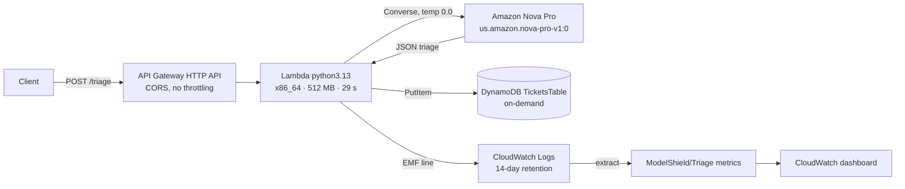
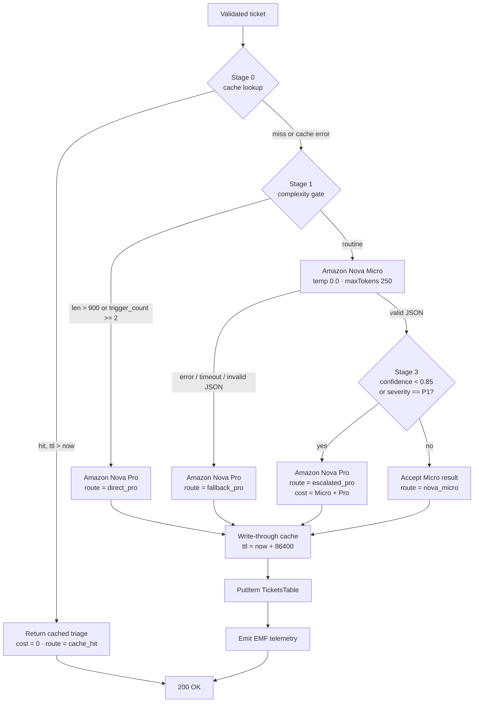

# ModelShield Architecture

Two stacks, one codebase, one API contract. `modelshield-v1` is the
conventional baseline; `modelshield-v2` is the same workload after one cohesive
Sustainability + Cost Optimization fix. Both are deployed side by side in
`us-east-1` so the benchmark can measure the delta rather than argue about it.

## v1-before — the conventional baseline



Every request pays for frontier inference: routine password resets and invoice
questions cost exactly the same per token as a multi-region outage. There is no
repeat-detection layer, no per-request ceiling, and the function is sized for a
CPU-bound workload even though the handler is I/O-bound on Bedrock.

Request path:

1. HTTP API validates CORS and forwards the JSON body.
2. `handler.lambda_handler` validates the payload (`schemas.validate_triage_request`).
3. `BedrockClient.converse` calls Converse with the deterministic prompt,
   retrying throttling/5xx up to three times with full jitter.
4. `schemas.parse_model_response` extracts the JSON object, normalises
   severity/category and clamps confidence.
5. `storage.save_triage` writes the record (fail-open).
6. `metrics.emit_triage_metrics` prints one EMF document to stdout.
7. The handler returns the triage body plus a `telemetry` block.

## v2-after — four-stage fail-open router



Stage contracts:

| Stage | Input | Decision | Failure behaviour |
| --- | --- | --- | --- |
| 0 Cache | Normalised SHA-256 of subject+body | TTL-valid item → return | Any DynamoDB error → log, treat as miss |
| 1 Gate | Length + high-risk keyword count | `> 900` chars or `>= 2` triggers → Pro | Pure function, cannot fail |
| 2 Micro | Routine ticket | Parse Micro JSON | Bedrock/parse error → Pro fallback |
| 3 Guardrail | Confidence + severity | `< 0.85` or `P1` → Pro | Escalation is always allowed |
| Write | Result + telemetry | Cache write-through | Cache write failure never fails the response |

Cache key normalisation: lowercase, collapse whitespace, strip ticket IDs,
UUIDs and ISO-8601 timestamps. That is what lets four alert-burst variants of
the same incident collapse to one paid inference and three `$0.00` hits.

## Data model

`TicketsTable` (v1 and v2)

| Attribute | Type | Notes |
| --- | --- | --- |
| `ticket_id` | S (PK) | Caller-supplied, unique per ticket |
| `severity`, `category`, `confidence` | S/N | Model output after validation |
| `summary`, `draft_reply` | S | Customer-facing narrative |
| `telemetry` | M | Full cost/latency/routing record |
| `created_at` | S | ISO-8601 UTC |
| `request_id` | S | API Gateway request id for correlation |

`ResponseCacheTable` (v2 only)

| Attribute | Type | Notes |
| --- | --- | --- |
| `cache_key` | S (PK) | Normalised SHA-256 hex |
| `payload` | M | Triage body to replay |
| `expires_at` | N | Epoch seconds, DynamoDB TTL attribute |
| `created_at` | S | ISO-8601 UTC |

## Economics

Prices used by the code (us-east-1 on-demand, per token):

| Model | Input / 1M | Output / 1M |
| --- | --- | --- |
| `us.amazon.nova-pro-v1:0` | $0.80 | $3.20 |
| `us.amazon.nova-micro-v1:0` | $0.035 | $0.14 |

```
request_cost   = input_tokens × input_rate + output_tokens × output_rate
gb_seconds     = (memory_mb / 1024) × (latency_ms / 1000)
cost_per_10k   = total_benchmark_cost / tickets × 10_000
cost_per_win   = total_benchmark_cost / correctly_classified_tickets
tokens_avoided = 100 × (1 − v2_frontier_tokens / v1_frontier_tokens)
```

Escalated requests are billed as **Micro + Pro**, and `frontier_tokens_used`
counts only tokens that actually hit Nova Pro. That is deliberately
conservative: it makes the savings claim defensible.

## Accepted cross-pillar trade-offs

| Trade-off | Cost / Sustainability win | Reliability / Security cost | Mitigation |
| --- | --- | --- | --- |
| 24-hour cache TTL | Repeat alerts cost $0 and no GPU-equivalent compute | A triage answer can be up to 24 h stale for a semantically identical ticket | Cache only normalised *routine* text; incident bursts benefit most; TTL is a parameter, not a constant |
| Second Bedrock hop on escalation | 70–85% of routine traffic never touches Pro | Adds ~1–2 s tail latency for the ~5–10% escalated requests | Escalate only below 0.85 confidence or P1; p95 target is still sub-second for the bulk |
| Nova Micro for routine tickets | ~23× cheaper input, ~23× cheaper output | Small model may misclassify edge cases | Deterministic prompt + confidence gate + P1 guardrail + Pro fallback on invalid JSON |
| API throttling (25 r/s, burst 50) | Caps runaway Bedrock spend | Legitimate bursts can receive 429 | Burst headroom above benchmark peak; clients should retry with backoff |
| arm64 / 256 MB | Roughly halves GB-seconds for the same wall time | Native deps would need an arm64 build | Zero third-party deps; pure Python zip builds anywhere |
| Fail-open cache | A cache outage degrades to v1 behaviour, not an outage | Costs revert to Pro pricing during the incident | Writes/reads catch `ClientError`; a warning is logged, request continues |

## Observability contract

One EMF document per request under `ModelShield/Triage`, dimensioned by
`StackVersion` (`v1` or `v2`):

| Metric | Unit | Meaning |
| --- | --- | --- |
| `EstimatedCostUSD` | None | Exact token cost for this request |
| `LatencyMs` | Milliseconds | End-to-end handler time |
| `LambdaGBSeconds` | None | Compute footprint |
| `FrontierTokens` | Count | Tokens that hit Nova Pro |
| `CacheHit` | Count | 0/1 |
| `Escalated` | Count | 0/1 |
| `FallbackTriggered` | Count | 0/1 |

The dashboard in `infra/template.yaml` plots average cost, p95 latency,
frontier tokens, cache/escalation/fallback counts and Lambda GB-seconds, so the
same evidence is visible in the AWS console without any custom tooling.

## What v2 changes, file by file

| File | Change |
| --- | --- |
| `backend/src/cache.py` | New: normalised SHA-256 key builder + fail-open TTL client |
| `backend/src/router.py` | New: four-stage state machine, escalation accounting, fallback |
| `backend/src/handler.py` | Delegates to the router when `STACK_VERSION=v2` |
| `backend/src/metrics.py` | Emits cache/escalation/fallback counts (already in schema) |
| `infra/template.yaml` | `ResponseCacheTable`, arm64, 256 MB, API throttling, IAM for Nova Micro + cache table |
| `backend/tests/test_router.py` | New: hit, miss, fail-open, gate, escalation, fallback |
| `eval/run_benchmark.py` | Unchanged contract; produces the before/after report |

One fix, one PR, one measurable delta.
