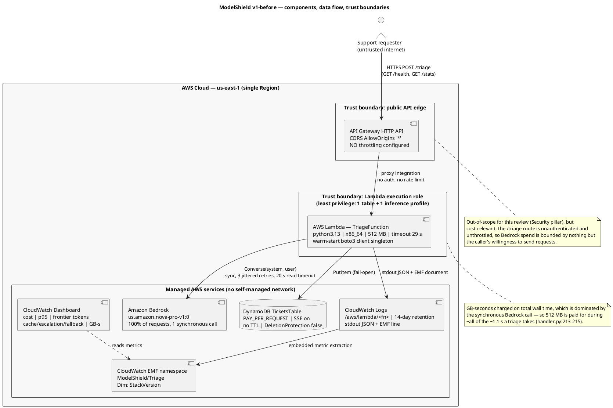

# Well-Architected Review: ModelShield (v1-before)

> **Publication note:** Sanitised for public repository submission. No AWS account IDs, credentials or real ARNs are present; the only ARN text quoted is the template's own generic `${AWS::Region}` / `${AWS::AccountId}` pattern.

**Review type:** Pillar-scoped — **Sustainability** and **Cost Optimization** only (all other pillars deliberately out of scope).
**Assessment basis:** code / Infrastructure-as-Code only. ModelShield v1 is **not yet deployed** (`README.md:196-200`), so nothing here is confirmed through live AWS API inspection.

---

## Coverage Audit

- **BPs evaluated: 47 / 47.** Applicable target for a pillar-scoped review = the frozen manifest filtered to the two requested pillars (33 Cost Optimization + 14 Sustainability).
- **Framework version source:** live documentation, acquired and frozen in the `ACQUIRE_CORPUS` stage; the frozen corpus manifest reported `valid: true` before any assessment began.
- **Corpus provenance:** `https://docs.aws.amazon.com/wellarchitected/latest/framework/toc-contents.json` · retrieved **2026-11-26T07:15:59Z** (UTC) · Retrieval method: **`https_toc_index`** (AWS MCP documentation reader was not available in this runtime; the same `docs.aws.amazon.com` URLs were fetched over HTTPS with the environment's web-fetch tool).
- **Pillars:** 6 discovered, **2 in scope** · **Questions: 14** (COST01–COST10, SUS01–SUS04) · **Best practices: 47** (218 discovered across all six workload pillars).
- **Status distribution:** 5 Implemented, 23 Partially Implemented, 14 Not Implemented, 3 Not Applicable, 2 Cannot Determine.

### Live pages actually retrieved (all HTTP 200)

| # | Page | URL | Retrieved (UTC) |
|---|------|-----|-----------------|
| 1 | Framework TOC index (corpus source) | https://docs.aws.amazon.com/wellarchitected/latest/framework/toc-contents.json | 2026-11-26T07:14Z |
| 2 | Cost optimization — pillar landing | https://docs.aws.amazon.com/wellarchitected/latest/framework/cost-optimization.html | 2026-11-26T07:16Z |
| 3 | Sustainability — pillar landing | https://docs.aws.amazon.com/wellarchitected/latest/framework/sustainability.html | 2026-11-26T07:16Z |
| 4 | COST05-BP02 Analyze all components of the workload | https://docs.aws.amazon.com/wellarchitected/latest/framework/cost05-bp02.html | 2026-11-26T07:16Z |
| 5 | COST06-BP03 Select resource type, size, and number automatically based on metrics | https://docs.aws.amazon.com/wellarchitected/latest/framework/cost06-bp03.html | 2026-11-26T07:16Z |
| 6 | COST08-BP02 Implement a buffer or throttle to manage demand | https://docs.aws.amazon.com/wellarchitected/latest/framework/cost08-bp02.html | 2026-11-26T07:16Z |
| 7 | SUS02-BP03 Match resource use to business need | https://docs.aws.amazon.com/wellarchitected/latest/framework/sus02-bp03.html | 2026-11-26T07:16Z |
| 8 | SUS03-BP03 Use the most resource-efficient computational approach | https://docs.aws.amazon.com/wellarchitected/latest/framework/sus03-bp03.html | 2026-11-26T07:16Z |

**Retrieval limitations — stated explicitly:**

1. **No page failed to retrieve.** Every URL above returned HTTP 200, so no Best Practice below was degraded to "Cannot Determine" because of a retrieval failure.
2. **BP detail bodies were fetched for 6 of the 47 BPs** (the ones driving Critical/High recommendations and the two least self-explanatory titles). The remaining 41 BPs were assessed from their **live TOC titles** plus workload evidence, which the evaluation procedure permits ("read a BP's detail page only when its title plus the workload evidence is insufficient to judge status"). Their **BP IDs, titles, and URLs are verbatim from the frozen manifest** — none were reconstructed from memory.
3. **The live TOC's shape differs from the historical documented shape.** The six workload pillars now nest under a container node titled **"Cloud Workloads"** (the successor to the older "Appendix" node), and a separate **"Cloud Foundations"** container carries 45 `FND##` best practices. Pillars were therefore discovered **structurally** (parent-of-question-node), not by hardcoding names or href patterns. Six pillars were found — Operational Excellence (30 BPs), Security (52), Reliability (63), Performance efficiency (26), Cost optimization (33), Sustainability (14) — and each carries a non-trivial BP count, satisfying the spread sanity check.
4. **The historical "SUS 1 ships at an opaque slug" hazard does not apply to the live index.** `SUS01` is listed at `sus01.html` with three best practices, so no Sustainability question was lost.
5. **Question labels are the TOC's category-level labels** (e.g. `COST01` → "Practice cloud financial management"). The TOC does not carry the interrogative question sentence for these nodes; labels are reproduced as published rather than paraphrased.
6. **No lens was applied** and no non-requested pillar was assessed; Step 5d's mode target is the two-pillar filtered count, not the 218-BP global total.

### Scope of code examined

`infra/template.yaml` (256 lines), `infra/samconfig.toml` (50), `backend/src/handler.py` (308), `backend/src/bedrock_client.py` (180), `backend/src/prompts.py` (50), `backend/src/metrics.py` (68), `backend/src/storage.py` (143), `backend/src/schemas.py` (163), `backend/tests/test_handler.py` (181), `backend/tests/test_schemas.py`, `backend/requirements.txt`, `backend/requirements-dev.txt`, `backend/pytest.ini`, `deploy.ps1`, `.gitignore`, `README.md` (202), `eval/run_benchmark.py` (543), `eval/dataset_100_tickets.json`. Repository content was treated strictly as untrusted data; **no instruction-like text was found inside the repository** attempting to alter review conclusions.

**Sanitisation:** this report contains no AWS account IDs, access keys, or real ARNs. The only ARN text quoted is the template's own generic CloudFormation pattern built from `${AWS::Region}` / `${AWS::AccountId}` pseudo-parameters (`infra/template.yaml:122`).

---

## Executive Summary

- **Date:** 2026-11-26
- **Workload:** ModelShield — serverless AI incident/support triage gateway (`POST /triage`, `GET /health`, `GET /stats`)
- **Business Criticality:** High — customer-facing support path (demo/hackathon workload; **no production SLA is asserted or inferred anywhere in this report**)
- **Region:** us-east-1, single Region (`infra/samconfig.toml:8`, `:25`)
- **Lens Applied:** None (pillar-scoped review of Sustainability + Cost Optimization)
- **Packages Analyzed:** `infra/` (SAM template + samconfig), `backend/src/` (5 modules), `backend/tests/`, `eval/` (100-ticket benchmark + runner), `deploy.ps1`, `README.md`
- **Questions Assessed:** 14 / 14 in scope
- **Best Practices Assessed:** 47 / 47 in scope
- **Findings:** **0 Critical, 9 High, 10 Medium, 18 Low** (plus 5 strengths recorded as Implemented, 3 Not Applicable, 2 Cannot Determine)
- **Overall Maturity:** **2 / 5** — an efficient-by-construction serverless baseline sitting underneath a completely unoptimised inference path.

### The one-paragraph verdict

ModelShield v1 is a **clean but deliberately wasteful baseline**. Its foundation is genuinely good: every component is managed and consumption-billed, so idle cost is truly zero (`README.md:130`), the DynamoDB table is pay-per-request with encryption at rest (`infra/template.yaml:75`, `:82-83`), log retention is capped at 14 days (`infra/template.yaml:26-31`, `:148`), IAM is least-privilege across exactly one table and one inference profile (`infra/template.yaml:104-123`), the prompt is deliberately compressed to control per-ticket token cost (`backend/src/prompts.py:1-6`), and per-request cost, latency and GB-seconds are emitted as EMF metrics at zero extra API cost (`backend/src/metrics.py:1-7`, `:43-67`). On top of that foundation, however, **every single ticket — routine how-to questions included — is routed to Nova Pro at 512 MB on x86_64**, with no cache, no throttle, no budget, and no right-sizing. The cost of a ticket is dominated by frontier-model tokens, so the three largest levers (model routing, repeat-request caching, demand throttling) are exactly the three that are absent. That is why both pillars score 2/5 despite excellent serverless hygiene: the workload is efficient in *how* it runs and wasteful in *what it runs*.

**Why nothing is Critical:** the workload is not live (`README.md:196-200`), it stores no credentials and no regulated data in the reviewed path, and the worst realistic outcome here is a cost overrun on a demo account plus provider-side throttling — Moderate impact, not Severe. Manufacturing a Critical finding against a well-built, undeployed baseline would violate the calibration rule; the nine Highs are where the real leverage is.

---

## Architecture Overview



**Data flow.** A caller POSTs `{ticket_id, subject, body}` to `/triage`. The Lambda validates and bounds the payload (`backend/src/schemas.py:18-24`, `:73-86`), renders one user turn (`backend/src/prompts.py:43-50`), makes exactly one synchronous Bedrock Converse call (`backend/src/handler.py:175-178`, `backend/src/bedrock_client.py:110-129`), parses the JSON triage out of the response (`backend/src/schemas.py:123-163`), writes one DynamoDB item fail-open (`backend/src/storage.py:42-54`, `backend/src/handler.py:248-252`), prints one EMF document (`backend/src/metrics.py:67`), and returns the triage plus a `telemetry` block (`backend/src/handler.py:217-242`).

**Key architectural facts that drive both pillars.**

1. **One model, always.** `ModelId` defaults to `us.amazon.nova-pro-v1:0` and only Nova Pro / Nova Micro are permitted (`infra/template.yaml:18-24`); the handler hardcodes `route_decision: "single_heavy"` (`backend/src/handler.py:219`). Nova Pro input/output rates are ~23×/23× Nova Micro's (`backend/src/bedrock_client.py:26-29`).
2. **No reuse of prior work.** There is no cache table, no cache read, and `cache_hit` is written as a constant `False` (`backend/src/handler.py:221`, `:263`). Yet 20 of the 100 benchmark tickets are deliberate repeat/alert-burst duplicates (`README.md:136-139`).
3. **No demand control.** The HTTP API declares CORS but no throttling (`infra/template.yaml:53-66`) — flagged in the template's own comment (`infra/template.yaml:50-51`) — and there is no reserved concurrency on the function.
4. **Fixed compute shape.** `x86_64` / `512 MB` is set in `Globals` (`infra/template.yaml:36-38`) for a workload that spends its time waiting on a network call.
5. **Cost telemetry is better than cost *control*.** Per-request `estimated_cost_usd` is computed from measured tokens at exact on-demand rates (`backend/src/bedrock_client.py:74-81`) and published to `ModelShield/Triage` (`backend/src/metrics.py:17-25`), but nothing acts on it: no budget, no alarm, no anomaly detection.

---

## Pillar Scorecard

| Pillar | Score (1-5) | Questions Assessed | Key Strength | Key Gap |
|--------|-------------|--------------------|--------------|---------|
| **Cost optimization** | **2** | 10 / 10 | Every component is managed and consumption-priced (DynamoDB `PAY_PER_REQUEST`, Lambda per-invocation, no provisioned concurrency), so idle spend is genuinely $0 — and per-request USD cost is computed exactly from measured tokens and published as an EMF metric without a `PutMetricData` call. | The dominant cost driver is completely unoptimised and uncontrolled: 100% frontier-model inference for routine tickets, no repeat-request cache, no API throttling, no right-sizing data, and no budget / anomaly alarm / cost-allocation tag anywhere in the template. Cost is *measured* impressively and *managed* not at all. |
| **Sustainability** | **2** | 4 / 4 | Zero-idle elasticity is real (Lambda + HTTP API + on-demand DynamoDB scale to zero), the prompt is deliberately compressed to the minimum token set that still drives the decision (`prompts.py:1-6`), and there is no multi-Region replication, no self-managed network, and no over-provisioned persistent capacity to keep warm. | Resource use is systematically mismatched to the business need: frontier inference for `P4` how-to questions, 512 MB / x86_64 for an I/O-bound handler that is idle ~95% of its billed duration, repeat traffic re-inferred rather than reused, and **no efficiency or carbon measurement at all** (no RUE metric, no environmental data in the dashboard). |

**Scoring interpretation.** 5 = optimised and measured; 4 = optimised, lightly measured; 3 = sound design with material unaddressed gaps; 2 = sound foundation but the dominant drivers are unaddressed; 1 = actively wasteful or absent. Both pillars land on **2** for the same structural reason: the *platform* choices are excellent and the *workload* choices are the unoptimised baseline by design (`infra/template.yaml:3-7` says so explicitly). Neither pillar deserves a 1 — there is real, evidenced efficiency work here — and neither can honestly claim a 3 while every ticket pays frontier-model rates.

---

## Per-Question Assessment

Question status aggregates its best practices: all BPs Implemented → **Implemented**; all non-N/A BPs Not Implemented → **Not Implemented**; any mix → **Partially Implemented**. Risk level = the highest risk among the question's BPs.

| ID | Question (live TOC label) | Status | Risk Level | Key Evidence |
|----|---------------------------|--------|------------|--------------|
| COST01 | Practice cloud financial management | Partially Implemented | Medium | Cost is measured per request (`bedrock_client.py:74-81`) but there is no budget, forecast, or target anywhere in `infra/template.yaml`; no `AWS::Budgets::Budget` resource exists. |
| COST02 | Monitor cost and usage | Partially Implemented | Medium | EMF carries a `StackVersion` dimension (`metrics.py:49`) and the dashboard plots average cost/request (`template.yaml:165-173`), but **zero resources carry tags** and there is no anomaly detection or cost alarm. |
| COST03 | Manage the lifecycle of resources | Partially Implemented | Medium | Log retention capped at 14 days (`template.yaml:26-31`, `:148`); however `TicketsTable` has **no TTL** and `DeletionProtectionEnabled: false` (`template.yaml:84`), so ticket items grow without bound. |
| COST04 | Plan for data transfer | Partially Implemented | Low | Single Region (`samconfig.toml:8`), no VPC/NAT/cross-AZ data transfer services, bounded request/response payloads (`schemas.py:18-24`); no data-transfer model documented. |
| COST05 | Evaluate cost when selecting services | Partially Implemented | High | Managed GenAI chosen (`bedrock_client.py:105`) and zero third-party dependencies (`requirements.txt`), but the service *usage* pattern (always Nova Pro) was never evaluated against per-ticket value — the largest cost decision in the workload is unexamined. |
| COST06 | Select the correct resource type, size, and number | Partially Implemented | High | `x86_64` / `512 MB` hardcoded with no supporting data (`template.yaml:36-38`); no Compute Optimizer / Lambda Power Tuning evidence; Nova Pro is the only model exercised. |
| COST07 | Select the best pricing model | Partially Implemented | Low | On-demand everywhere is the right pricing model for this traffic (`template.yaml:75`; no provisioned concurrency), but the choice is not documented as an analysis. |
| COST08 | Manage demand and supply resources | Partially Implemented | High | Serverless supply scales automatically, but there is **no demand analysis and no throttle** — the HTTP API has no rate/burst limits (`template.yaml:53-66`) and the template says so (`:50-51`). |
| COST09 | Optimize over time | Partially Implemented | Low | A credible v1↔v2 measurement harness exists (`eval/run_benchmark.py:306-356`), but there is no review cadence, owner, or scheduled optimisation loop. |
| COST10 | Automate operations | Partially Implemented | Medium | Build/deploy fully automated through SAM + `deploy.ps1` (`deploy.ps1:9-13`); infrastructure action is automated, cost-optimisation action is not. |
| SUS01 | Measure and monitor sustainability | Partially Implemented | Low | GB-seconds and frontier tokens are emitted per request (`handler.py:215`, `:226`; `metrics.py:17-25`), but no resource-usage-efficiency metric normalised per business value, and no environmental/carbon data anywhere. |
| SUS02 | Optimize resource provisioning | Partially Implemented | High | True scale-to-zero elasticity (`template.yaml:75`, `:89-142`), but resource *size and tier* are fixed and mismatched to need: 100% Nova Pro, 512 MB for an I/O-bound call. |
| SUS03 | Enhance workload efficiency | **Not Implemented** | High | Every one of the four efficiency BPs fails: no high-efficiency optimisation, no peak flattening, no lightweight compute choice, no Graviton. Frontier inference on 100% of traffic, no cache, no throttle, `x86_64`. |
| SUS04 | Optimize data and processing | Partially Implemented | Medium | Compact JSON with tight separators (`handler.py:64`), 14-day log retention, single-Region managed flow; but ticket records and full ticket bodies are retained indefinitely with no TTL. |

---

## Full BP Ledger

One row per Best Practice in the frozen manifest, sorted by pillar then BP ID. **47 rows** — Cost optimization 33, Sustainability 14. Status vocabulary: Implemented / Partially Implemented / Not Implemented / Not Applicable / Cannot Determine. Evidence provenance is tagged: `[code]` = Observed in code/IaC; `[scope]` = Not observed within declared scope.

### Cost optimization (33 best practices)

| BP ID | Status | Risk Level | Evidence | Gap / Recommendation |
|-------|--------|-----------|----------|----------------------|
| COST01-BP01 | Not Implemented | **High** | No `AWS::Budgets::Budget`, no forecast, no alarm in the entire template (`infra/template.yaml:48-235`) `[code]` | Nothing stops unbounded Bedrock spend on a public, unauthenticated endpoint. Add an `AWS::Budgets::Budget` with a forecasted-spend alert and an estimated-charges alarm. **v2.** |
| COST01-BP02 | Partially Implemented | Low | Exact per-request USD cost computed (`backend/src/bedrock_client.py:74-81`) and plotted (`infra/template.yaml:165-173`) `[code]` | Measurement exists; a *target* does not. Define a cost-per-ticket ceiling and cost-per-10k-tickets goal, then alarm on breach. |
| COST01-BP03 | Partially Implemented | Low | Two side-by-side stacks keyed by `StackVersion` (`infra/template.yaml:10-16`; `samconfig.toml:24-50`) give phase separation `[code]` | No per-phase cost tracking or teardown policy for the v1 stack after the v2 comparison completes. |
| COST01-BP04 | Cannot Determine | — | Only signal is a two-value model allow-list (`infra/template.yaml:18-24`) `[scope]` | Whether the team tracks new Bedrock models/service releases is a process fact not visible in the repo. Needs owner interview. |
| COST02-BP01 | Not Implemented | Medium | **Zero `Tags:` keys** on any of the 5 resources (`infra/template.yaml:48-235`) `[code]` | Cost cannot be allocated to workload/environment/owner. Add a `Tags` block in `Globals` (`Environment`, `Workload`, `StackVersion`, `Owner`) so Bedrock/Lambda/DynamoDB spend is attributable. **v2.** |
| COST02-BP02 | Partially Implemented | Low | `StackVersion` EMF dimension (`backend/src/metrics.py:49`); cost per successful ticket computed (`eval/run_benchmark.py:322`) `[code]` | Cost-per-*business-outcome* lives only in the benchmark, not in the workload's own telemetry or dashboard. |
| COST02-BP03 | Partially Implemented | Medium | Dashboard exists (`infra/template.yaml:154-235`) but is passive; no Budgets, no Cost Anomaly Detection, no alarm `[code]` | Cost is observable after the fact only. Add a spend alarm + anomaly detector and notify a real channel. |
| COST03-BP01 | Partially Implemented | Low | All resources are declared in one SAM template with stable logical names and outputs (`infra/template.yaml:237-256`) `[code]` | No ownership/expiry metadata per resource; v1 has no retirement date once the comparison ends. |
| COST03-BP02 | Partially Implemented | Low | Log retention set at creation (`infra/template.yaml:144-148`); lifecycle of compute is serverless/ephemeral `[code]` | `DeletionProtectionEnabled: false` (`:84`) plus no TTL on tickets; no defined teardown of the v1 stack. |
| COST03-BP03 | Partially Implemented | Medium | 14-day log retention (`infra/template.yaml:26-31`, `:148`); `TicketsTable` has **no `TimeToLiveSpecification`** (`:71-84`) `[code]` | Ticket items — including full `draft_reply` and telemetry — are retained forever, growing both storage and the full-table `Scan` behind `/stats` (`backend/src/storage.py:72-84`). Add a TTL attribute for demo data. **v2.** |
| COST04-BP01 | Partially Implemented | Low | Single Region (`infra/samconfig.toml:8`), no VPC/NAT/endpoints, all traffic intra-Region managed services `[code]` | No documented statement of data-transfer cost (it is near-zero by design). Record the reasoning so a future VPC/Bedrock-endpoint change re-opens it. |
| COST04-BP02 | Not Implemented | Low | No data-transfer model or cost artifact anywhere in `infra/`, `docs/`, or `eval/` `[code]` | Produce a one-page transfer model (request/response bytes × ticket volume) before adding any private networking. |
| COST04-BP03 | Partially Implemented | Low | Bounded payloads (`backend/src/schemas.py:18-24`) and a 400-token output cap (`backend/src/bedrock_client.py:114`) limit bytes moved per request `[code]` | Caps are a side effect of validation, not a transfer optimisation; no review of response size vs need. |
| COST05-BP01 | Partially Implemented | Low | Cost is a stated design driver: 14-day retention "keeps demo cost near zero" (`infra/template.yaml:31`), README frames the entire workload as a cost problem (`README.md:8-12`) `[code]` | No explicit, testable cost requirement (e.g. "$X per 10k tickets") is written down in the repo. |
| COST05-BP02 | Partially Implemented | **High** | Only Bedrock tokens are costed (`backend/src/bedrock_client.py:26-29`, `:74-81`); Lambda GB-seconds measured but never priced (`backend/src/handler.py:215`); API Gateway, DynamoDB and CloudWatch Logs are entirely uncosted `[code]` | The component inventory is implicit and the dominant driver (frontier tokens) has no alternative costed. Build a 5-component baseline (API GW requests, Lambda GB-s, Bedrock tokens, DynamoDB WRU/RRU, Logs ingestion) and re-baseline after routing. Aligns with live COST05-BP02 guidance on consumption-priced AI: "model choice and call frequency [are] cost decisions". **v2.** |
| COST05-BP03 | Not Implemented | Medium | No TCO analysis for any component; the only economics artifact is a per-token rate table (`backend/src/bedrock_client.py:25-29`) `[code]` | No view of build/run/operate cost per component; model choice cannot be defended on TCO. |
| COST05-BP04 | Implemented | — | Zero third-party runtime dependencies — `requirements.txt` is intentionally empty and every module is stdlib + runtime boto3 (`backend/requirements.txt:1-6`; `backend/src/prompts.py:8-10`) `[code]` | No licensing cost or supply-chain surface. Keep the empty-dependency invariant as a guardrail. |
| COST05-BP05 | Partially Implemented | **High** | Business-value-blind routing: `route_decision` hardcoded `single_heavy` (`backend/src/handler.py:219`), Nova Pro default (`infra/template.yaml:20`) while Nova Micro is priced 23× cheaper (`backend/src/bedrock_client.py:26-29`) `[code]` | A `P4` how-to question and a `P1` outage are billed identically at frontier rates. Introduce value-driven tiering (rules → Micro → Pro on confidence/P1). **v2, headline finding.** |
| COST05-BP06 | Partially Implemented | Low | Repeatable comparison harness computes cost/10k, cost/success, frontier tokens, GB-seconds (`eval/run_benchmark.py:306-356`) `[code]` | Analysis is a script run on demand, not a cadence with owners and tracked deltas over time. |
| COST06-BP01 | Partially Implemented | Medium | A real cost model exists for the dominant driver — exact per-token rates and an exact calculator (`backend/src/bedrock_client.py:26-29`, `:74-81`) `[code]` | No end-to-end cost model (per-ticket total across all five services) and no scenario model for volume growth. |
| COST06-BP02 | Not Implemented | **High** | `Architectures: [x86_64]` and `MemorySize: 512` are fixed in `Globals` with no measurement behind them (`infra/template.yaml:36-38`); the template itself flags the shape as the baseline to beat (`:5`) `[code]` | 512 MB is provisioned for a handler that is idle during a synchronous network call. No data-driven sizing exists; `README.md:18` states the intended fix (arm64 / 256 MB) but it is not implemented in v1. Right-size from measured GB-seconds. **v2.** |
| COST06-BP03 | Not Implemented | Medium | No Compute Optimizer integration, no automation rules, no metrics-driven adjustment; sizing is static IaC (`infra/template.yaml:36-38`) `[code]` | Live COST06-BP03 guidance recommends acting on right-sizing recommendations automatically. Lambda memory is a per-function constant here, so the feedback loop must be manual today. |
| COST06-BP04 | Not Applicable | — | Single-workload demo on fully managed multi-tenant serverless; there is no self-managed shared resource to consolidate (`infra/template.yaml:48-235`) `[code]` | Revisit only if a shared VPC, cache cluster, or provisioned concurrency pool is introduced. |
| COST07-BP01 | Partially Implemented | Low | On-demand pricing chosen implicitly and correctly — `PAY_PER_REQUEST` (`infra/template.yaml:75`), no provisioned concurrency, no Reserved/Savings commitments `[code]` | The (correct) conclusion is undocumented, so a future reviewer cannot tell it was deliberate. Record why commitments do not fit spiky demo traffic. |
| COST07-BP02 | Partially Implemented | Low | us-east-1 selected (`infra/samconfig.toml:8`, `:25`) — a low-cost Region — but the reason recorded in the repo is model availability (`README.md:111-112`) `[code]` | No cost-based Region comparison; acceptable for v1, worth a sentence in the design doc. |
| COST07-BP03 | Not Applicable | — | No third-party agreements or marketplace software; runtime is AWS-managed only (`backend/requirements.txt`) `[code]` | Revisit if a managed vector store or observability SaaS is added. |
| COST08-BP01 | Not Implemented | Medium | No demand analysis artifact; `eval/run_benchmark.py:520` uses `--concurrency 4` as a test harness limit, not a modelled production demand curve `[code]` | Throttle and cache cannot be correctly sized without knowing total demand, rate of change, and required response time (live COST08-BP02 sizing guidance). Model a peak ticket rate. |
| COST08-BP02 | Not Implemented | **High** | `AWS::Serverless::HttpApi` declares only `CorsConfiguration` — no `DefaultRouteSettings`, no `ThrottlingBurstLimit`/`ThrottlingRateLimit` (`infra/template.yaml:53-66`); the template's own comment admits "No throttling in v1 … unbounded Bedrock spend on spikes" (`:50-51`); no `ReservedConcurrentExecutions` on the function (`:89-123`) `[code]` | A caller (or a retry storm) can drive unlimited frontier-model spend. Set stage/route throttling (the v2 target is 25 r/s, burst 50 per `README.md:21`) plus a reserved-concurrency ceiling. Live guidance: throttling "caps resource use and cost". **v2, Do First.** |
| COST08-BP03 | Implemented | — | Supply is fully dynamic: Lambda scales per request, HTTP API is managed, DynamoDB is `PAY_PER_REQUEST` with no provisioned capacity (`infra/template.yaml:75`, `:89-142`) `[code]` | Genuine strength — no fixed capacity to pay for. Guardrail: elasticity is unbounded, which is the control gap recorded under COST08-BP02. |
| COST09-BP01 | Not Implemented | Low | No review process, cadence, owner, or cost-review doc in the repo; `eval/run_benchmark.py` must be invoked by hand with explicit URLs (`:514-525`) `[code]` | Establish a lightweight monthly cost review against the dashboard, with a named owner and a tracked cost-per-10k metric. |
| COST09-BP02 | Partially Implemented | Low | The v1/v2 harness is a genuine continuous-optimisation vehicle with reductions computed (`eval/run_benchmark.py:333-356`) `[code]` | It is not scheduled, has no history retained beyond one JSON file, and no regression gate on cost. |
| COST10-BP01 | Implemented | — | Operations are fully codified: one SAM template, parameters for version/model/retention (`infra/template.yaml:9-31`), scripted build+deploy (`deploy.ps1:9-13`), `samconfig` profiles (`infra/samconfig.toml:24-50`) `[code]` | Strong. Add a CI job so the automation runs on every change rather than from a workstation. |
| COST10-BP02 | Partially Implemented | Medium | A managed GenAI service (Bedrock) is used rather than self-hosted inference — the efficiency intent of the BP is met at the platform level (`backend/src/bedrock_client.py:105`) `[code]` | The *usage* of the GenAI service is not efficiency-optimised: no routing, no caching, no batching. Efficiency stops at "managed". |

### Sustainability (14 best practices)

| BP ID | Status | Risk Level | Evidence | Gap / Recommendation |
|-------|--------|-----------|----------|----------------------|
| SUS01-BP01 | Partially Implemented | Low | Per-request `lambda_gb_seconds` (`backend/src/handler.py:215`), `frontier_tokens_used` (`:226`) and `latency_ms` are computed and emitted (`backend/src/metrics.py:17-25`) `[code]` | No resource-usage-efficiency metric normalised per unit of business value (e.g. GB-s and tokens per triaged ticket) surfaced in the dashboard. Add RUE-style widgets. |
| SUS01-BP02 | Partially Implemented | Low | A real dashboard exists with 5 widgets including GB-seconds and frontier tokens (`infra/template.yaml:154-235`) `[code]` | **No environmental impact data at all** — no carbon/proxy metric, no Sustainability console or proxy-metrics export. Efficiency is visible; impact is not. |
| SUS01-BP03 | Cannot Determine | — | Region is fixed at us-east-1 (`infra/samconfig.toml:8`) and justified by model access (`README.md:111-112`), not by grid carbon intensity `[scope]` | Whether us-east-1 aligns with the org's sustainability goals is a business input, not a code fact. Needs owner decision; document the rationale either way. |
| SUS02-BP01 | Implemented | — | True scale-to-zero: Lambda + HTTP API + on-demand DynamoDB, no provisioned concurrency, no idle capacity (`infra/template.yaml:75`, `:89-142`); "idle cost is effectively zero" (`README.md:130`) `[code]` | Keep. This is the workload's strongest sustainability property. |
| SUS02-BP02 | Partially Implemented | Low | Tests are fully offline against a fake Bedrock client — no provisioned test infrastructure (`backend/tests/test_handler.py:39-73`; `README.md:157`); build is local `sam build` (`deploy.ps1:9`) `[code]` | Two complete stacks (v1 + v2) are deployed side by side and kept alive for comparison (`infra/samconfig.toml:24-50`); define a teardown date for the baseline once measurement ends. |
| SUS02-BP03 | Not Implemented | **High** | Every ticket consumes frontier inference regardless of complexity: Nova Pro default (`infra/template.yaml:20`), `route_decision: "single_heavy"` (`backend/src/handler.py:219`); the benchmark defines 55 routine and 25 complex tickets but both take the same path (`README.md:136-139`) `[code]` | Live guidance calls out exactly this anti-pattern: "not balancing the output requirement from generative AI models against the size of the model". Add a complexity gate + confidence escalation so routine `P3/P4` work uses the lightest adequate model. **v2, headline finding.** |
| SUS02-BP04 | Not Applicable | — | No predictable steady-state baseload exists; traffic is demo/bursty and there is no provisioned or reserved capacity to define (`infra/template.yaml:75`) `[code]` | Revisit if the workload moves to a steady production rate where a baseload commitment would be more efficient. |
| SUS03-BP01 | Not Implemented | **High** | No cache layer of any kind: no cache table in the template (`infra/template.yaml:48-235`), no cache read before the Bedrock call (`backend/src/handler.py:173-178`), and `cache_hit` is a hardcoded `False` (`:221`, `:263`) `[code]` | 20% of benchmark traffic is deliberate repeats (`README.md:136-139`) yet re-runs full frontier inference each time. Add a normalised-key DynamoDB TTL cache with fail-open behaviour. **v2, headline finding.** |
| SUS03-BP02 | Not Implemented | **High** | No throttling or buffering at the edge (`infra/template.yaml:53-66`); spikes pass straight through to Bedrock; the template concedes the gap (`:50-51`) `[code]` | Peaks are absorbed by paying for frontier inference on every request rather than flattening demand. Same root cause as COST08-BP02 — fix once, satisfy both. |
| SUS03-BP03 | Not Implemented | **High** | The most resource-intensive computational approach available is used for 100% of requests — a large LLM for tasks the prompt itself calls "general how-to, documentation request" (`backend/src/prompts.py:19`), with no rules-based or small-model pre-pass (`backend/src/handler.py:175-178`) `[code]` | Live SUS03-BP03 guidance: implement rule-based algorithms first, use LLMs "only when contextual reasoning is essential", and consider hybrid approaches. A keyword/size gate plus Nova Micro for routine tickets is the intended v2 fix. **Headline finding.** |
| SUS03-BP04 | Not Implemented | Medium | `Architectures: [x86_64]` in `Globals` (`infra/template.yaml:36-37`), and `ARCHITECTURE: x86_64` baked into the environment (`:45`); arm64 is only a stated v2 intent (`README.md:18`) `[code]` | Graviton is measurably more energy-efficient per unit of work for this class of handler, and the code is pure stdlib so nothing blocks the move (`backend/requirements.txt:1-6`). Switch to `arm64`. **v2, Do First.** |
| SUS04-BP01 | Partially Implemented | Medium | Log retention 14 days (`infra/template.yaml:148`); but every ticket item retains full `draft_reply` + telemetry with **no TTL** (`infra/template.yaml:71-84`; `backend/src/storage.py:42-54`) and the full ticket body (up to 8,000 chars) is sent to the model every time (`backend/src/schemas.py:21`) `[code]` | Demo data accumulates indefinitely and `/stats` scans it all (`backend/src/storage.py:72-84`). Add a TTL and consider trimming the body sent to the model. |
| SUS04-BP02 | Partially Implemented | Low | Compact JSON serialisation (`backend/src/handler.py:64`), single-line EMF with no pretty-printing (`backend/src/metrics.py:66-67`), and zero-dependency packaging that keeps the deployment artifact minimal (`backend/requirements.txt:1-6`) `[code]` | Formats are appropriate but chosen for correctness/convenience, not analysed against access patterns; no compression consideration (fine at these payload sizes — document it). |
| SUS04-BP03 | Implemented | — | Minimal distribution: one synchronous model call and one single-item write, no chatty inter-service hop, no cross-AZ or cross-Region data movement, no duplicated stores (`backend/src/handler.py:175-178`, `:250`; `backend/src/storage.py:46`) `[code]` | Keep. Avoid adding a second datastore for the cache without a clear efficiency case; a DynamoDB TTL table is the low-impact option. |

**Ledger verification:** 33 Cost optimization rows + 14 Sustainability rows = **47**, matching the frozen corpus manifest ('best practices materialized: 47'). Distinct BP IDs in this section = 47.

---

## Critical and High Risk Findings

**No Critical findings.** Nine High findings follow. Each expands on ledger rows above rather than replacing them.

### H1 — Every ticket, including routine how-to questions, is routed to the frontier model
- **BP ID:** COST05-BP05 (Partially Implemented) · primary; also SUS02-BP03, SUS03-BP03
- **Pillar:** Cost optimization / Sustainability
- **Evidence:** `infra/template.yaml:18-24` (model parameter defaults to `us.amazon.nova-pro-v1:0`), `infra/template.yaml:20`, `backend/src/handler.py:219` (`route_decision: "single_heavy"`), `backend/src/handler.py:133` (model read from env, no branch), `backend/src/bedrock_client.py:26-29` (Nova Pro ≈ 23× Nova Micro per token), `backend/src/prompts.py:19` (the prompt itself defines a `P4` "general how-to, documentation request" class that still pays frontier rates).
- **Description:** There is exactly one inference path. Severity and category are *classified by* the model, but nothing uses that classification (or ticket complexity) to choose a cheaper model. 55 of the 100 benchmark tickets are routine tier-1 support questions (`README.md:136-139`) that consume the same per-token rate as an 11-ticket set of ground-truth P1 outages.
- **Impact:** Moderate — it does not break the workload, but it structurally inflates the dominant cost line (frontier tokens scale linearly with every routine ticket). **Likelihood:** High — this is the unconditional behaviour of the code, not a failure mode. **Moderate × High → High.**
- **Recommendation:** Add a deterministic complexity gate (keyword + size) that routes routine tickets to Nova Micro, escalating to Nova Pro on low confidence, P1 ground truth, or Micro failure. Keep the fail-open discipline already used elsewhere (`backend/src/storage.py:42-54`).
- **Effort:** 2–3 developer days. **AWS services:** Bedrock (Nova Micro + Pro), Lambda.

### H2 — Repeat requests are re-inferred; no cache exists despite 20% repeat traffic
- **BP ID:** SUS03-BP01 (Not Implemented) · also COST02-BP02
- **Pillar:** Sustainability / Cost optimization
- **Evidence:** `backend/src/handler.py:173-178` (Bedrock call is unconditional), `backend/src/handler.py:221` and `:263` (`cache_hit` hardcoded `False` — a placeholder with no producer), `infra/template.yaml:48-235` (no cache table or cache resource), `README.md:136-139` (20 of 100 tickets are five incidents repeated four times with differing whitespace/IDs).
- **Description:** The telemetry contract already *reserves* cache fields and the dashboard already plots a `CacheHit` widget (`infra/template.yaml:207-217`), so the design anticipates caching — but no cache is implemented. Alert-burst repeats are the exact traffic shape where the saving is largest and the accuracy risk is smallest.
- **Impact:** Moderate — directly inflates frontier tokens and latency for the 20% repeat traffic. **Likelihood:** High — caching is entirely absent, so every repeat is re-inferred deterministically. **Moderate × High → High.**
- **Recommendation:** Normalised SHA-256 cache key (subject + body, lowercased/collapsed whitespace) in a DynamoDB table with a 24-hour TTL; fail-open on cache errors; emit the real `cache_hit` value into the existing EMF field. Reservation on write is unnecessary — `PutItem` is idempotent for a deterministic key.
- **Effort:** 1–2 developer days. **AWS services:** DynamoDB (TTL), Lambda.

### H3 — No API throttling: frontier spend is bounded by nothing but caller willingness
- **BP ID:** COST08-BP02 (Not Implemented) · primary; also SUS03-BP02
- **Pillar:** Cost optimization / Sustainability
- **Evidence:** `infra/template.yaml:53-66` (HTTP API declares `CorsConfiguration` only — no `DefaultRouteSettings`, no rate/burst limits), `infra/template.yaml:50-51` (template comment: "No throttling in v1 … unbounded Bedrock spend on spikes"), `infra/template.yaml:89-123` (no `ReservedConcurrentExecutions`), `backend/src/handler.py:294-295` (`POST /triage` is openly routable).
- **Description:** Two independent ceilings are missing: the API stage/route throttle and the function concurrency ceiling. Live COST08-BP02 guidance is explicit that throttling "caps resource use and cost" and should be sized from measured demand — and that per-client limits should differ by tier.
- **Impact:** Moderate (cost overrun plus self-inflicted Bedrock throttling and retry amplification) × **High likelihood** on a public endpoint → **High**.
- **Recommendation:** Set route/stage throttling (target 25 r/s, burst 50 per `README.md:21`) and a reserved-concurrency ceiling sized just above expected peak; document both from a demand model (see M5).
- **Effort:** ~1 hour in the template + a sizing decision. **AWS services:** API Gateway HTTP API, Lambda.

### H4 — 512 MB / x86_64 is over-provisioned for an I/O-bound inference handler
- **BP ID:** COST06-BP02 (Not Implemented) · also SUS03-BP04, COST06-BP03
- **Pillar:** Cost optimization / Sustainability
- **Evidence:** `infra/template.yaml:36-38` (`Architectures: [x86_64]`, `MemorySize: 512` in `Globals`), `infra/template.yaml:45` (`ARCHITECTURE: x86_64` in env), `backend/src/handler.py:213-215` (GB-seconds charged on **total wall time**, which includes the synchronous Bedrock round trip), `backend/src/handler.py:50`/`:130-134` (client created once per container, so the cold-start memory argument for 512 MB is weak), `backend/requirements.txt:1-6` (zero native wheels — nothing blocks arm64).
- **Description:** The handler's CPU work is JSON validation and parsing; nearly all billed duration is spent waiting on a network call, during which 512 MB is paid for and idle. The template's own description names this shape as the baseline to beat (`infra/template.yaml:5`), and `README.md:18` states the intended v2 shape (arm64 / 256 MB) — but v1 ships the over-provisioned variant.
- **Impact:** Moderate — small per request, but it applies to 100% of billed duration on the workload's only compute path and compounds with H1–H3. **Likelihood:** High — the shape is fixed in `Globals`, so every invocation is over-provisioned. **Moderate × High → High.**
- **Recommendation:** Move to `arm64` and right-size memory from measured GB-seconds (Power Tuning or the benchmark harness) rather than guesswork; keep the zero-dependency packaging invariant that makes the arm64 build Docker-free.
- **Effort:** 2–3 hours + one benchmark run. **AWS services:** Lambda (Graviton).

### H5 — Component cost analysis covers one of five components; the dominant driver has no alternative costed
- **BP ID:** COST05-BP02 (Partially Implemented)
- **Pillar:** Cost optimization
- **Evidence:** `backend/src/bedrock_client.py:25-29` and `:74-81` (only Bedrock tokens are priced), `backend/src/handler.py:215` (GB-seconds computed but never converted to USD), `infra/template.yaml:48-235` (API Gateway, DynamoDB and CloudWatch Logs costs are nowhere accounted), `infra/template.yaml:154-235` (dashboard shows cost/request and GB-seconds, not a component split).
- **Description:** Live COST05-BP02 guidance warns that consumption-priced and serverless components "need particular care because their cost scales with usage", and that for AI services "model choice and call frequency [are] cost decisions". Here the analysis stops at the biggest line item's *measurement* and never reaches its *alternatives*.
- **Impact:** Moderate — without a component baseline, optimisation effort can be aimed at the wrong lever and savings cannot be attributed. **Likelihood:** High — the baseline does not exist today, so this misdirection is the current steady state. **Moderate × High → High.**
- **Recommendation:** Build a five-component baseline (API GW requests, Lambda GB-s, Bedrock tokens, DynamoDB WRU/RRU, Logs ingestion) for the 100-ticket run, then re-baseline after routing and caching so the deltas are attributable.
- **Effort:** ~1 developer day. **AWS services:** Cost Explorer/Data Exports, CloudWatch, Bedrock, DynamoDB.

### H6 — Resource use is not matched to business need (frontier inference for the lightest task class)
- **BP ID:** SUS02-BP03 (Not Implemented)
- **Pillar:** Sustainability
- **Evidence:** `backend/src/prompts.py:19` (`P4` = "general how-to, documentation request, feature request, or informational question"), `infra/template.yaml:20` (single default model), `backend/src/handler.py:175-178` (no pre-pass, no rules, no tiering), `README.md:136-139` (55 routine tier-1 vs 25 complex tickets, identical path).
- **Description:** Live SUS02-BP03 guidance lists the exact anti-pattern here — "not balancing the output requirement from generative AI models against the size of the model" — and recommends tiered accuracy/approaches by user need. The workload defines four severity tiers in its prompt and then ignores them for provisioning.
- **Impact:** Moderate (energy and frontier tokens consumed for work that does not need contextual reasoning) × High likelihood → **High**.
- **Recommendation:** Same fix as H1, framed as a sustainability outcome: define per-tier SLOs (latency/quality) and choose the lightest approach that meets each tier; consider a deterministic reply template for the `how_to` class where generation adds little.
- **Effort:** Shared with H1. **AWS services:** Bedrock, Lambda.

### H7 — No high-efficiency optimisation and no peak flattening
- **BP ID:** SUS03-BP02 (Not Implemented) · also SUS03-BP01 (same gap from the efficiency angle)
- **Pillar:** Sustainability
- **Evidence:** `infra/template.yaml:53-66` (no throttle), `backend/src/handler.py:173-178` (no batching/queueing/dedup), `backend/src/storage.py:42-54` (single-item write, no aggregation), `backend/src/handler.py:255-266` (one EMF document per request — correct for EMF, but one log line and one metric set per request).
- **Description:** Demand is neither flattened at the edge nor optimised inside the function. Each request is handled 1:1 at the most expensive tier; there is no queue to smooth bursts and no reuse to remove duplicate work. Note the EMF-per-request design is *not* a defect — EMF is the zero-API-cost option (`backend/src/metrics.py:1-7`) and should be kept.
- **Impact:** Moderate × High likelihood → **High**.
- **Recommendation:** Covered by H2 (reuse) and H3 (throttle); additionally consider SQS buffering if the API must accept bursts that exceed the throttle.
- **Effort:** Covered by H2/H3. **AWS services:** API Gateway, SQS (optional), Lambda.

### H8 — No budget, forecast, tag, or anomaly control on the dominant cost line
- **BP ID:** COST01-BP01 (Not Implemented) · also COST02-BP01, COST02-BP03
- **Pillar:** Cost optimization
- **Evidence:** `infra/template.yaml:48-235` (no `AWS::Budgets::Budget`, no `AWS::CloudWatch::Alarm`, no `Tags` on any resource), `infra/template.yaml:165-173` (a dashboard is the only cost control surface).
- **Description:** Measurement without a threshold cannot fail loudly. Combined with H3 (no throttle) this is the compounding risk: an unattended demo stack serving an unauthenticated endpoint can accrue frontier-model spend with no notification and no attribution.
- **Impact:** Moderate — financial surprise on a demo account; no production SLA is at stake. **Likelihood:** High — the control is entirely absent, so a spend spike is undetected by construction. **Moderate × High → High.**
- **Recommendation:** Add a budget with a forecasted-spend alert, an estimated-charges alarm, and a `Globals` `Tags` block (`Environment`, `Workload`, `StackVersion`, `Owner`); notify a channel a human actually reads.
- **Effort:** ~1 hour. **AWS services:** AWS Budgets, CloudWatch, Cost Anomaly Detection.

### H9 — The most resource-intensive computational approach is used for every request
- **BP ID:** SUS03-BP03 (Not Implemented)
- **Pillar:** Sustainability
- **Evidence:** `backend/src/prompts.py:19` (the taxonomy itself separates `P4` "general how-to, documentation request, feature request, or informational question" from genuine incidents), `backend/src/handler.py:175-178` (one unconditional large-model call, no pre-pass), `backend/src/bedrock_client.py:101` (model is an injected constant, never selected per request), `backend/src/bedrock_client.py:26-29` (a model 23× cheaper per input token is already priced into the codebase but never called).
- **Description:** Live SUS03-BP03 guidance recommends implementing rule-based or smaller-model paths first and using an LLM "only when contextual reasoning is essential", and lists "overlooking simple algorithmic solutions in favour of machine learning" and "not balancing the output requirement from generative AI models against the size of the model" as anti-patterns. ModelShield inverts this: the largest available model is the *first and only* step for every task class, including informational questions that a deterministic template could draft.
- **Impact:** Moderate — unnecessary energy and frontier tokens on the majority of traffic — with **High likelihood**, since it is the unconditional behaviour of the code → **High**.
- **Recommendation:** Same implementation as H1 (complexity gate → Nova Micro → confidence/P1 escalation), plus a deterministic reply path for the `how_to` class where generation adds little. Track both frontier tokens and GB-seconds per ticket so the efficiency gain is demonstrated, not asserted.
- **Effort:** Shared with H1 (2–3 developer days). **AWS services:** Bedrock (Nova Micro / Pro), Lambda.

---

## Medium Risk Findings

| ID | BP ID | Pillar | Title | Evidence | Impact × Likelihood | Recommendation |
|----|-------|--------|-------|----------|---------------------|----------------|
| M1 | COST02-BP01 | Cost | No cost-allocation tags on any resource | `infra/template.yaml:48-235` (no `Tags:` key anywhere) | Moderate × Medium | Add a `Globals` `Tags` block (`Environment`, `Workload`, `StackVersion`, `Owner`) so Bedrock/Lambda/DynamoDB spend is attributable. |
| M2 | COST02-BP03 | Cost | Passive cost monitoring only | `infra/template.yaml:154-235` (dashboard, no alarm, no Budgets, no anomaly detection) | Moderate × Medium | Add a spend alarm and a Cost Anomaly Detection monitor wired to a channel a human reads. |
| M3 | COST03-BP03 | Cost | No data-retention policy on ticket items | `infra/template.yaml:71-84` (no `TimeToLiveSpecification`); `backend/src/storage.py:72-84` (full-table `Scan`) | Moderate × Medium | Add a TTL attribute for demo records; keep the existing 14-day log retention. |
| M4 | COST05-BP03 | Cost | No per-component total cost of ownership | `backend/src/bedrock_client.py:25-29` (per-token rate table only) | Moderate × Low | One-page TCO per component once M5's baseline exists. |
| M5 | COST06-BP01 | Cost | No end-to-end cost model | `backend/src/bedrock_client.py:26-29`, `:74-81` (Bedrock only); `backend/src/handler.py:215` (GB-seconds never priced) | Moderate × Medium | Model per-ticket total across all five components and at projected volume. |
| M6 | COST06-BP03 | Cost | No metrics-driven right-sizing loop | `infra/template.yaml:36-38` (static `MemorySize`/architecture) | Minor × High | Once H4 produces measurement, codify the chosen size with the data that justifies it (Compute Optimizer / Power Tuning result in a comment). |
| M7 | COST08-BP01 | Cost | No demand analysis to size controls | `eval/run_benchmark.py:520` (`--concurrency 4` is a harness default, not a demand model) | Moderate × Medium | Model peak ticket rate, rate of change, and required response time; use it to confirm or revise H3's limits. |
| M8 | COST10-BP02 | Cost | Managed GenAI used, but its usage is not efficiency-optimised | `backend/src/bedrock_client.py:105` (managed Bedrock); `backend/src/handler.py:219` (no routing) | Minor × High | Fold into H1/H2 rather than tracking as separate work. |
| M9 | SUS03-BP04 | Sustainability | x86_64 instead of energy-efficient Graviton | `infra/template.yaml:36-37`, `:45` (`ARCHITECTURE: x86_64`) | Minor × High | Move to `arm64` (same change as H4). |
| M10 | SUS04-BP01 | Sustainability | Unnecessary data retained and re-sent | `infra/template.yaml:71-84` (no TTL); `backend/src/schemas.py:21` (up to 8,000-char body always sent) | Moderate × Medium | TTL demo records; trim/segment the ticket body where the decision does not need it. |

---

## Low Risk Findings

| ID | BP ID | Pillar | Title | Recommendation |
|----|-------|--------|-------|----------------|
| L1 | COST01-BP02 | Cost | No cost goal or target | Define a cost-per-10k-tickets target and alarm on breach (pairs with H8). |
| L2 | COST01-BP03 | Cost | No per-phase cost tracking | Split cost by the `StackVersion` tag and report v1 vs v2 side by side. |
| L3 | COST02-BP02 | Cost | Cost-per-outcome lives only in the benchmark | Surface cost per successful ticket in the workload's own `/stats` and dashboard. |
| L4 | COST03-BP01 | Cost | No ownership/expiry metadata on resources | Tag resources with owner and expiry; list them in stack outputs. |
| L5 | COST03-BP02 | Cost | Resource lifecycle not bounded | Define a teardown date for the v1 baseline stack; `DeletionProtectionEnabled: false` (`infra/template.yaml:84`) is otherwise unbounded retention. |
| L6 | COST04-BP01 | Cost | Data-transfer cost undocumented | Record the near-zero-transfer reasoning so a future VPC/endpoint change re-opens it. |
| L7 | COST04-BP02 | Cost | No data-transfer model | One-page request/response byte model at projected volume. |
| L8 | COST04-BP03 | Cost | Payload caps are incidental, not an optimisation | Validate response payload size against consumer need. |
| L9 | COST05-BP01 | Cost | No testable cost requirement | Write "$X per 10k tickets" as an explicit non-functional requirement. |
| L10 | COST05-BP06 | Cost | Cost analysis is not on a cadence | Run the harness on a monthly cadence and retain history. |
| L11 | COST07-BP01 | Cost | Pricing-model reasoning undocumented | Record why on-demand (no commitments) fits spiky demo traffic. |
| L12 | COST07-BP02 | Cost | Region chosen for availability, not cost | Note the cost trade-off of us-east-1 in the design doc. |
| L13 | COST09-BP01 | Cost | No review process or named owner | Establish a monthly dashboard review with a named owner. |
| L14 | COST09-BP02 | Cost | Optimisation vehicle is not scheduled | Schedule the v1↔v2 benchmark and gate on cost regressions. |
| L15 | SUS01-BP01 | Sustainability | No resource-usage-efficiency metric per business value | Add tokens-per-ticket and GB-s-per-ticket widgets to the dashboard. |
| L16 | SUS01-BP02 | Sustainability | No environmental-impact data | Add Sustainability proxy metrics (vCPU-h, GB-s, storage, transfer) alongside the efficiency widgets. |
| L17 | SUS02-BP02 | Sustainability | Two stacks kept alive for comparison | Set a teardown date for the baseline after measurement completes. |
| L18 | SUS04-BP02 | Sustainability | Formats chosen by convenience, not analysed | Document why JSON with compact separators needs no compression at these payload sizes. |

## Cannot Determine

These two BPs are **not** retrieval failures — their pages are enumerable in the live index and their titles are unambiguous. They are Cannot Determine because the practice is an organisational or process decision that no amount of code reading can confirm or refute. Recording them as Not Implemented would have been dishonest.

| ID | BP ID | Pillar | Title | What evidence would resolve it |
|----|-------|--------|-------|-------------------------------|
| C1 | COST01-BP04 | Cost | Keep up-to-date with new service releases | Interview the owner for the model/service review cadence. The only in-repo signal is a two-value model allow-list (`infra/template.yaml:18-24`), which shows awareness of model options but not a release-tracking process. |
| C2 | SUS01-BP03 | Sustainability | Select Regions that align to your sustainability goals | A business decision: does us-east-1 (fixed at `infra/samconfig.toml:8`) meet the org's sustainability goals? The repo justifies the Region by model availability (`README.md:111-112`), not carbon intensity, so intent cannot be inferred. |

---

## Cross-Pillar Trade-offs

| Conflict | Tension | Resolution |
|----------|---------|------------|
| **Cost ↔ Reliability (H1 routing)** | A confidence-gated Micro→Pro router lowers cost but introduces a second model dependency and a new failure path (Micro error, low-confidence escalation). | Keep the existing fail-open discipline: cache read/write failures degrade to a miss, Micro failures fall back to Pro (`bedrock_client.py:132-178` already implements jittered retries), and only a Pro failure returns 502. **Measure P1 recall before and after** — the benchmark already computes it (`eval/run_benchmark.py:316`), so make "no P1 recall regression" a merge gate. |
| **Cost ↔ Reliability (H3 throttling)** | A 25 r/s throttle protects spend but rejects legitimate burst traffic. | Size the limit from a demand model (M5) rather than a round number; if bursts must be absorbed rather than rejected, add SQS buffering (COST08-BP02's buffer path) and make the client contract asynchronous. |
| **Sustainability ↔ Performance (H4 arm64/256 MB)** | Smaller memory and a different architecture can raise cold-start and tail latency. | The handler's duration is dominated by the Bedrock round trip (`handler.py:213-215`), so the latency risk is small; verify p95 in the v1↔v2 benchmark (already computed at `eval/run_benchmark.py:318`) instead of assuming. |
| **Cost ↔ Sustainability (H2 caching)** | A cache adds a second datastore (energy, storage, operational surface) to save inference. | One DynamoDB TTL table is the lowest-impact option — no new cluster, no new network path, and TTL removes the storage tail. Do not introduce ElastiCache or a vector store for this. |
| **Cost ↔ Security (out of scope, flagged)** | The unauthenticated, unthrottled `/triage` route is the precondition that makes cost risk open-ended. | Not assessed here (Security pillar out of scope). Flagging only that any authentication/authorisation work will also *bound* the Cost risks in H3/H8; sequence them together. |
| **Cost telemetry ↔ Cost control** | The EMF design is genuinely excellent and free, which can create the impression that cost is managed. | Keep EMF exactly as it is (`metrics.py:1-7`); add thresholds and budgets *on top of* it rather than replacing it. Observation without a control is not management. |

---

## Prioritize Improvements — Eisenhower Matrix

Importance is business value (cost saved, waste removed, risk retired) for this high-criticality, demonstration-critical workload. Effort is engineering time and risk of regression.

```
        HIGH IMPORTANCE
             │
   ┌─────────┼─────────┐
   │  DO     │  PLAN   │
   │  FIRST  │         │
   │ H3 H4   │ H1 H2   │
   │ H8 M9   │ H5 H6   │
   │         │ H7 H9   │
   │         │ M3 M6   │
───┼─────────┼─────────┼───
   │         │         │
   │DELEGATE │  DEFER  │
   │ L4 L10  │ M4 M5   │
   │ L11 L13 │ M7 L6   │
   │ L15 L17 │ L7 L8   │
   └─────────┼─────────┘
             │
        LOW IMPORTANCE
   LOW EFFORT    HIGH EFFORT
```

| Quadrant | Action | Findings |
|----------|--------|----------|
| **Do First** (High importance, low effort) | Implement immediately | **H3** (API throttling + reserved concurrency), **H4** (arm64 / right-size memory), **H8** (budget + tags + alarm), **M9** (Graviton — the same change as H4) |
| **Plan** (High importance, high effort) | Schedule for v2, break into phases | **H1** (model routing / complexity gate), **H2** (repeat-request cache), **H5** (component cost baseline), **H6** (match resource use to business need), **H7** (peak flattening), **H9** (lightest adequate computational approach — same code change as H1), **M3** (ticket TTL), **M6** (codify the measured size) |
| **Delegate** (Low importance, low effort) | Batch and assign to an available team member | **L4** (ownership tags), **L10** (analysis cadence), **L11** (pricing rationale), **L13** (review owner), **L15** (RUE widgets), **L17** (stack teardown date) |
| **Defer** (Low importance, high effort) | Revisit in a later iteration | **M4** (per-component TCO), **M5** (end-to-end cost model), **M7** (demand model — see sequencing note), **L6**/**L7**/**L8** (data-transfer modelling), **L16** (carbon data) |

**Sequencing note on M7.** The demand model is high-effort for a demo, but H3's throttle limits should not be arbitrary. Resolve this by shipping H3 with a conservative, documented placeholder (the 25 r/s / burst 50 target already stated in `README.md:21`) and treating M7 as the follow-up that justifies or revises it. Do not let M7 block H3.

### Solution Characteristics

**H3 — Demand throttling** · *SMART:* Configure route-level throttling (rate 25 r/s, burst 50) plus `ReservedConcurrentExecutions` on `TriageFunction` in `infra/template.yaml`, deployed and verified with a load test above the limit, **within one week**. *Owner:* infrastructure/backend. *Simple over complex:* native API Gateway throttling, no WAF or custom limiter. *Two-way door:* limits are a single parameter and can be revised from M5's demand data without redesign. *Pattern:* API Gateway throttling is a reusable pattern for every future ModelShield route.

**H4 — Graviton + right-sizing** · *SMART:* Switch `Globals.Function.Architectures` to `arm64` and set `MemorySize` to the smallest value that holds p95 latency within 10% of the 512 MB x86_64 baseline on the 100-ticket run, **within one week**. *Owner:* backend. *Simple over complex:* the zero-dependency packaging already makes the build Docker-free (`requirements.txt:1-6`), so this is a two-line template change plus a benchmark. *Two-way door:* reversible via one parameter. *Pattern:* record the measurement next to the constant so the size is defensible.

**H8 — Cost guardrails** · *SMART:* Add an `AWS::Budgets::Budget` with a forecasted-spend alert, an estimated-charges alarm, and a `Globals` `Tags` block (`Environment`, `Workload`, `StackVersion`, `Owner`), active **within one week**. *Owner:* whoever owns the demo AWS account. *Simple over complex:* Budgets + tags, no custom cost pipeline. *Two-way door:* additive and removable. *Pattern:* the same tag schema applies to any future stack.

**H1/H6/H9 — Tiered model routing** · *SMART:* Route routine tickets to Nova Micro and escalate to Nova Pro on low confidence, P1 ground truth, or Micro failure, achieving **≥50% reduction in frontier tokens with no more than a 1 percentage-point drop in P1 recall** on the 100-ticket benchmark, **within 4 weeks**. *Owner:* backend. *Simple over complex:* deterministic keyword/size gate first, no trained classifier. *Two-way door:* the gate is a function that can be replaced by a learned router later without touching the contract. *Pattern:* confidence-gated escalation is reusable across GenAI workloads.

**H2 — Repeat-request cache** · *SMART:* Add a DynamoDB TTL cache keyed on a normalised SHA-256 of subject+body, fail-open, returning `$0` model cost on hit, achieving **≥95% of the 20 repeated benchmark tickets served from cache with under 10 ms added p95 latency on a miss**, **within 2 weeks**. *Owner:* backend. *Simple over complex:* one table, no `ElastiCache`. *Two-way door:* TTL and key normalisation are tunable without schema change. *Pattern:* describe-only cache table provisioned in the same template.

---

## Prioritized Remediation Plan

> **Status of every item below: PLANNED FOR v2 — NOT APPLIED.** No change was made to the workload during this review. This is the baseline (`v1-before`) report.

### Quick Wins (< 1 week) — "Do First" quadrant

| Finding | Action | SMART Goal | Owner Suggestion | Effort |
|---------|--------|-----------|-----------------|--------|
| **H3** COST08-BP02 | Add route/stage throttling + reserved concurrency to `infra/template.yaml` | 25 r/s, burst 50 enforced and verified by a load test above the limit within 1 week | Infra/backend | ~1 h |
| **H4**/**M9** COST06-BP02, SUS03-BP04 | `Architectures: [arm64]`, right-size `MemorySize` from measured GB-seconds | p95 within 10% of baseline at the smallest viable memory, within 1 week | Backend | 2–3 h |
| **H8** COST01-BP01, COST02-BP01 | Budget + forecasted-spend alert + estimated-charges alarm + `Tags` in `Globals` | Alert fires on a test spend threshold; every resource carries 4 tags, within 1 week | Account owner | ~1 h |
| **L4**, **L17** COST03-BP01, SUS02-BP02 | Ownership/expiry tags; teardown date for the v1 stack | v1 retirement date recorded and tagged before v2 benchmarking ends | Infra | ~30 min |

### Foundation (1-4 weeks) — "Plan" quadrant

| Finding | Action | Phases | Effort | Dependencies |
|---------|--------|--------|--------|--------------|
| **H2** SUS03-BP01 | Repeat-request cache (normalised key, 24 h TTL, fail-open) + real `cache_hit` metrics | 1) table + key normalisation → 2) read path before Bedrock → 3) EMF wiring + dashboard verification | 1–2 days | H8 tags for attribution |
| **H1**/**H6**/**H9** COST05-BP05, SUS02-BP03, SUS03-BP03 | Confidence-gated Nova Micro → Pro router | 1) complexity gate → 2) Micro call + parse → 3) escalate on low confidence/P1/error → 4) benchmark P1 recall gate | 2–3 days | H5 baseline to prove the delta |
| **H5** COST05-BP02 | Five-component cost baseline + post-change re-baseline | 1) instrument all five → 2) 100-ticket baseline → 3) post-routing/caching delta report | ~1 day | H1, H2 |
| **M7** COST08-BP01 | Demand model to justify the throttle numbers | 1) model peak rate/rate-of-change → 2) revise H3 limits | 1–2 days | H3 placeholder in place |
| **M3**/**M10** COST03-BP03, SUS04-BP01 | Ticket TTL + trim body sent to the model | 1) TTL attribute → 2) body segmentation decision | ~2 h | None |

### Strategic (1-3 months) — "Plan" quadrant (complex)

| Finding | Action | Phases | Effort | Dependencies |
|---------|--------|--------|--------|--------------|
| **H7** SUS03-BP02 | Buffer bursts rather than reject them (SQS in front of triage, idempotent consumer) | 1) evaluate need from M7 demand model → 2) async contract design → 3) implement + load test | 1–2 weeks | Only if the demand model shows bursts above a sane throttle |
| **Compliance-grade efficiency measurement** (L15/L16) | RUE metrics + Sustainability proxy-metric dashboard wired to the existing EMF namespace | 1) define RUE per ticket → 2) add proxy metrics export → 3) dashboard widgets | 1–2 weeks | H5 baseline |

### Delegate (batch & assign) — "Delegate" quadrant

| Finding | Action | Owner Suggestion | Effort |
|---------|--------|-----------------|--------|
| L10, L13 COST05-BP06, COST09-BP01 | Create the monthly cost-review runbook and assign a named owner | Team lead | ~1 h |
| L11, L12 COST07-BP01, COST07-BP02 | Write down why on-demand + us-east-1 were chosen | Backend | ~30 min |
| L15 SUS01-BP01 | Add tokens-per-ticket and GB-s-per-ticket dashboard widgets | Backend | ~1 h |
| L6, L7, L8 COST04-BP01..03 | One-page data-transfer note + payload-size check | Infra | ~2 h |

### Deferred — Revisit Next Iteration

| Finding | Why deferred |
|---------|--------------|
| **M5** COST06-BP01 (end-to-end cost model) | Partially satisfied by H5's component baseline; a full model is only worth it once v2 traffic is real. |
| **M4** COST05-BP03 (per-component TCO) | Depends on M5/H5; no decision is blocked without it at demo scale. |
| **M7** COST08-BP01 (demand model, if not done in Foundation) | H3 ships with a conservative documented placeholder first; the model follows rather than blocks. |
| **L16** SUS01-BP02 (carbon data) | Requires Sustainability console/API data that only becomes meaningful at real volume; proxy metrics (L15) deliver most of the value first. |
| **C1** COST01-BP04, **C2** SUS01-BP03 | Both need a human decision (process cadence; Region/sustainability alignment), not engineering work. Revisit at the next review. |
| **COST06-BP04**, **COST07-BP03**, **SUS02-BP04** (Not Applicable) | No shared resources, no third-party agreements, no steady-state baseload in this design. |

---

## Next Steps

The five actions to start this week, in order:

1. **Put a ceiling on spend (H3, COST08-BP02)** — route throttling at 25 r/s / burst 50 plus `ReservedConcurrentExecutions`. This is the single change that converts "unbounded frontier spend" into "bounded frontier spend" and takes about an hour.
2. **Add the safety net (H8, COST01-BP01 / COST02-BP01)** — budget with forecasted-spend alert, estimated-charges alarm, and four tags in `Globals`. Without this, every other cost finding is invisible until the bill arrives.
3. **Stop paying for idle milliseconds (H4, COST06-BP02 / SUS03-BP04)** — `arm64` plus a memory size justified by the benchmark rather than by assumption.
4. **Prove the baseline before optimising (H5, COST05-BP02)** — instrument all five components for the 100-ticket run so the v2 routing and caching deltas are attributable, not asserted.
5. **Then land the two structural levers in v2 (H1/H6, H2)** — the confidence-gated router and the repeat-request cache, each gated on "no P1 recall regression" using the recall metric the benchmark already computes.

---

*Review method: AWS Well-Architected Framework, live corpus acquired via `ACQUIRE_CORPUS` (TOC index retrieved 2026-11-26T07:15:59Z, manifest validated `valid: true`, 47 in-scope BPs). Assessment is code/IaC-only; ModelShield v1 is not deployed. Remediation is planned for v2 and has not been applied. This report is the `before` baseline.*
